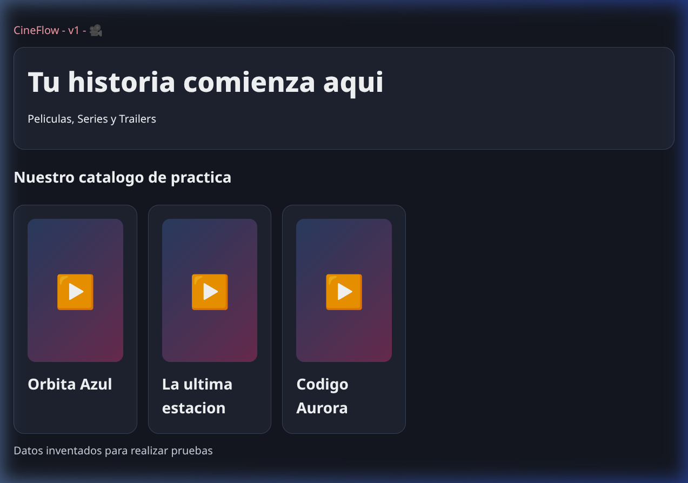
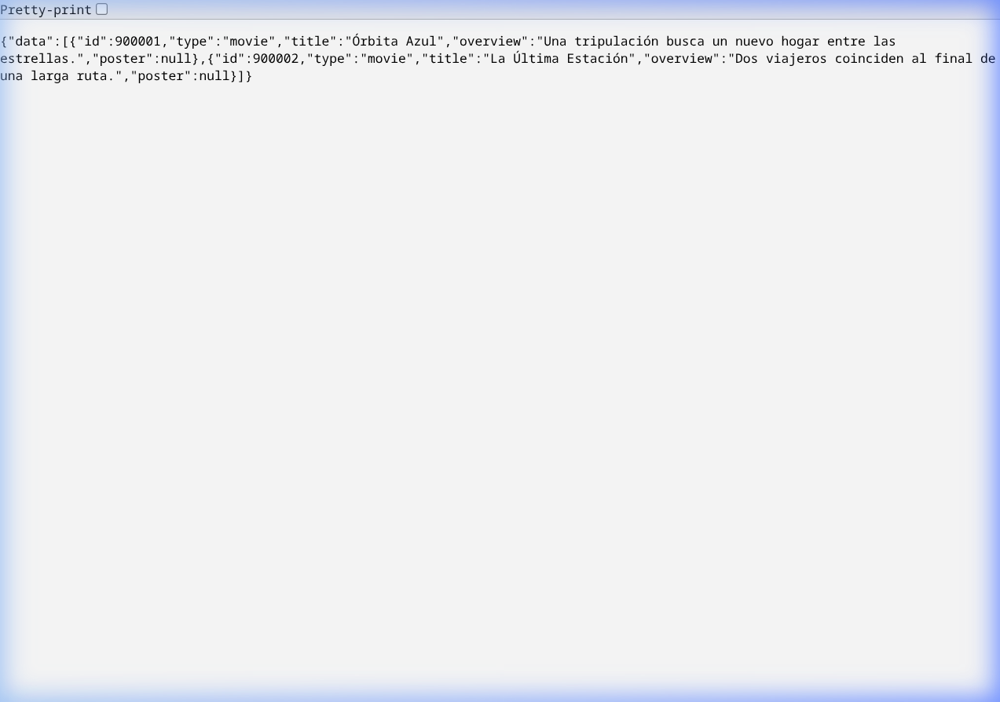
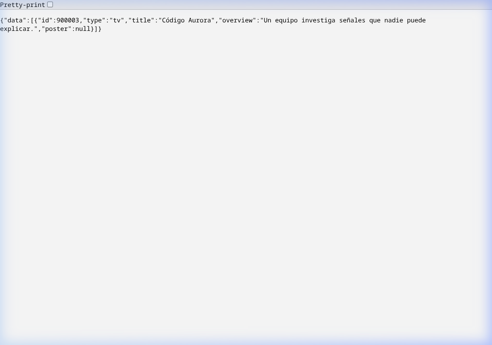

# Evidencia — Arquitectura CineFlow: Backend con Express, Firebase Admin, Firestore y Frontend Inicial con React y Vite

**Nombre:** Fernando Daniel Tolentino Uribe  
**NUA:** 395108  
**Universidad:** Universidad de Guanajuato (DICIS, Campus Irapuato-Salamanca)  
**Carrera:** Ingeniería en Sistemas Computacionales  
**Materia:** Cómputo en la Nube  
**Fecha:** 22 de Septiembre de 2026  

---

## 📁 `apps/api/src/server.ts`

```typescript
import "dotenv/config";
import { z } from "zod";
import { createApp } from "./app.js";
import { makeCatalog } from "./catalog.js";
import { store, verify } from "./store.js";
const env = z
  .object({
    PORT: z.coerce.number().default(4000),
    CORS_ORIGIN: z.string().url().default("http://localhost:5173"),
    CATALOG_MODE: z.enum(["demo", "tmdb"]).default("demo"),
  })
  .parse(process.env);
if (process.env.NODE_ENV === "production" && env.CATALOG_MODE !== "tmdb")
  throw new Error("Producción requiere CATALOG_MODE=tmdb");
createApp({
  store,
  verify,
  catalog: makeCatalog(env.CATALOG_MODE),
  origin: env.CORS_ORIGIN,
}).listen(env.PORT, () =>
  console.log(
    `CineFlow API: http://localhost:${env.PORT} — catálogo ${env.CATALOG_MODE}`,
  ),
);
```

---

## 📁 `apps/api/src/app.ts`

```typescript
import express from "express";
import cors from "cors";
import helmet from "helmet";
import { rateLimit } from "express-rate-limit";
import { randomUUID } from "node:crypto";
import { z } from "zod";
import {
  addProfile,
  mediaSchema,
  nameSchema,
  Problem,
  profileOf,
  progressSchema,
  saveHistory,
  type Media,
} from "./model.js";
import type { Store } from "./store.js";
import type { Catalog } from "./catalog.js";
export function createApp(deps: {
  store: Store;
  verify: (token: string) => Promise<string>;
  catalog: Catalog;
  origin: string;
}) {
  const app = express();
  app.disable("x-powered-by");
  app.use(helmet());
  app.use(cors({ origin: deps.origin }));
  app.use(express.json({ limit: "8kb" }));
  app.use(
    rateLimit({
      windowMs: 60000,
      limit: 120,
      standardHeaders: "draft-8",
      legacyHeaders: false,
    }),
  );
  app.get("/health", (_req, res) => res.json({ ok: true }));
  app.get("/api/catalog", async (req, res) => {
    const query = z
      .object({
        type: z.enum(["movie", "tv"]).default("movie"),
        q: z.string().trim().max(100).default(""),
        page: z.coerce.number().int().min(1).max(500).default(1),
      })
      .parse(req.query);
    res.json({
      data: await deps.catalog.list(query.type, query.q, query.page),
    });
  });
  app.get("/api/catalog/:type/:id", async (req, res) => {
    const m = mediaSchema.parse(req.params);
    res.json({ data: await deps.catalog.detail(m.type, m.id) });
  });
  app.get("/api/catalog/:type/:id/videos", async (req, res) => {
    const m = mediaSchema.parse(req.params);
    res.json({ data: await deps.catalog.videos(m.type, m.id) });
  });
  app.use("/api", async (req, res, next) => {
    const token = req.headers.authorization?.match(/^Bearer (.+)$/)?.[1];
    if (!token) throw new Problem(401, "Inicia sesión");
    res.locals.uid = await deps.verify(token);
    next();
  });
  app.put("/api/me", async (_req, res) =>
    res.json({ data: await deps.store.change(res.locals.uid, (a) => a) }),
  );
  app.get("/api/me", async (_req, res) =>
    res.json({ data: await deps.store.read(res.locals.uid) }),
  );
  app.patch("/api/me", async (req, res) => {
    const { name } = nameSchema.parse(req.body);
    res.json({
      data: await deps.store.change(res.locals.uid, (a) => {
        a.name = name;
        return a;
      }),
    });
  });
  app.post("/api/profiles", async (req, res) => {
    const { name } = nameSchema.parse(req.body);
    const id = randomUUID();
    res.status(201).json({
      data: await deps.store.change(res.locals.uid, (a) => {
        addProfile(a, id, name);
        return a;
      }),
    });
  });
  app.patch("/api/profiles/:profileId", async (req, res) => {
    const { name } = nameSchema.parse(req.body);
    res.json({
      data: await deps.store.change(res.locals.uid, (a) => {
        profileOf(a, String(req.params.profileId)).name = name;
        return a;
      }),
    });
  });
  app.delete("/api/profiles/:profileId", async (req, res) => {
    await deps.store.change(res.locals.uid, (a) => {
      const p = profileOf(a, String(req.params.profileId));
      if (p.id === "main")
        throw new Problem(409, "El perfil principal no se puede borrar");
      a.profiles = a.profiles.filter((v) => v.id !== p.id);
    });
    res.status(204).end();
  });
  function compact(m: Media): Media {
    return { ...m, overview: "" };
  }
  app.put("/api/profiles/:profileId/favorites/:type/:id", async (req, res) => {
    const m = mediaSchema.parse(req.params);
    const id = String(req.params.profileId);
    profileOf(await deps.store.read(res.locals.uid), id);
    const media = compact(await deps.catalog.detail(m.type, m.id));
    await deps.store.change(res.locals.uid, (a) => {
      const p = profileOf(a, id);
      const key = `${m.type}_${m.id}`;
      if (!p.favorites[key] && Object.keys(p.favorites).length >= 50)
        throw new Problem(409, "Máximo 50 favoritos por perfil");
      p.favorites[key] ??= { media, addedAt: new Date().toISOString() };
    });
    res.json({ data: { saved: true } });
  });
  app.delete(
    "/api/profiles/:profileId/favorites/:type/:id",
    async (req, res) => {
      const m = mediaSchema.parse(req.params);
      await deps.store.change(res.locals.uid, (a) => {
        delete profileOf(a, String(req.params.profileId)).favorites[
          `${m.type}_${m.id}`
        ];
      });
      res.status(204).end();
    },
  );
  app.put("/api/profiles/:profileId/history/:type/:id", async (req, res) => {
    const m = mediaSchema.parse(req.params);
    const input = progressSchema.parse(req.body);
    const id = String(req.params.profileId);
    profileOf(await deps.store.read(res.locals.uid), id);
    if (
      !(await deps.catalog.videos(m.type, m.id)).some(
        (v) => v.id === input.videoId,
      )
    )
      throw new Problem(400, "El video no pertenece al título");
    const media = compact(await deps.catalog.detail(m.type, m.id));
    res.json({
      data: await deps.store.change(res.locals.uid, (a) =>
        saveHistory(profileOf(a, id), media, input),
      ),
    });
  });
  app.delete("/api/profiles/:profileId/history/:key", async (req, res) => {
    const key = z
      .string()
      .regex(/^(movie|tv)_\d+_[\w-]{11}$/)
      .parse(req.params.key);
    await deps.store.change(res.locals.uid, (a) => {
      delete profileOf(a, String(req.params.profileId)).history[key];
    });
    res.status(204).end();
  });
  app.use((_req, _res, next) => next(new Problem(404, "Ruta no encontrada")));
  app.use(
    (
      error: unknown,
      _req: express.Request,
      res: express.Response,
      _next: express.NextFunction,
    ) => {
      if (error instanceof z.ZodError) {
        res.status(400).json({ error: "Revisa los datos enviados" });
        return;
      }
      if (error instanceof SyntaxError && "body" in error) {
        res.status(400).json({ error: "JSON inválido" });
        return;
      }
      const status = error instanceof Problem ? error.status : 500;
      if (status === 500)
        console.error(
          "Error interno de la API; revisa la configuración de Firebase y sus permisos.",
        );
      res
        .status(status)
        .json({
          error:
            error instanceof Problem
              ? error.message
              : "Error interno del servidor",
        });
    },
  );
  return app;
}
```

---

## 📁 `apps/api/src/model.ts`

```typescript
import { z } from "zod";
export type Kind = "movie" | "tv";
export interface Media {
  id: number;
  type: Kind;
  title: string;
  overview: string;
  poster: string | null;
}
export interface Video {
  id: string;
  title: string;
}
export interface Favorite {
  media: Media;
  addedAt: string;
}
export interface History {
  media: Media;
  videoId: string;
  position: number;
  duration: number;
  version: number;
  completed: boolean;
  updatedAt: string;
}
export interface Profile {
  id: string;
  name: string;
  favorites: Record<string, Favorite>;
  history: Record<string, History>;
}
export interface Account {
  name: string;
  profiles: Profile[];
}
export const emptyAccount = (): Account => ({
  name: "Mi cuenta",
  profiles: [{ id: "main", name: "Principal", favorites: {}, history: {} }],
});
export class Problem extends Error {
  constructor(
    public status: number,
    message: string,
  ) {
    super(message);
  }
}
export const nameSchema = z
  .object({ name: z.string().trim().min(1).max(30) })
  .strict();
export const mediaSchema = z.object({
  type: z.enum(["movie", "tv"]),
  id: z.coerce.number().int().positive(),
});
export const progressSchema = z
  .object({
    videoId: z.string().regex(/^[\w-]{11}$/),
    position: z.number().finite().min(0),
    duration: z.number().finite().positive().max(14400),
    version: z.number().int().min(0),
  })
  .strict()
  .refine((v) => v.position <= v.duration, "La posición supera la duración");
export function profileOf(account: Account, id: string): Profile {
  const p = account.profiles.find((p) => p.id === id);
  if (!p) throw new Problem(404, "Perfil no disponible");
  return p;
}
export function addProfile(account: Account, id: string, name: string) {
  if (account.profiles.length >= 5)
    throw new Problem(409, "Máximo cinco perfiles");
  account.profiles.push({ id, name, favorites: {}, history: {} });
}
export function saveHistory(
  profile: Profile,
  media: Media,
  input: z.infer<typeof progressSchema>,
): History {
  const key = `${media.type}_${media.id}_${input.videoId}`;
  const old = profile.history[key];
  if ((old?.version ?? 0) !== input.version)
    throw new Problem(
      409,
      "El progreso cambió. Cierra el reproductor y vuelve a abrirlo.",
    );
  const item = {
    media,
    videoId: input.videoId,
    position: input.position,
    duration: input.duration,
    version: input.version + 1,
    completed: input.position / input.duration >= 0.95,
    updatedAt: new Date().toISOString(),
  };
  profile.history[key] = item;
  const keys = Object.keys(profile.history).sort((a, b) =>
    profile.history[b].updatedAt.localeCompare(profile.history[a].updatedAt),
  );
  for (const key of keys.slice(50)) delete profile.history[key];
  return item;
}
```

---

## 📁 `apps/api/src/catalog.ts`

```typescript
import { z } from "zod";
import { Problem, type Media, type Kind, type Video } from "./model.js";
export interface Catalog {
  list(type: Kind, q: string, page: number): Promise<Media[]>;
  detail(type: Kind, id: number): Promise<Media>;
  videos(type: Kind, id: number): Promise<Video[]>;
}
const demos: Media[] = [
  {
    id: 900001,
    type: "movie",
    title: "Órbita Azul",
    overview: "Una tripulación busca un nuevo hogar entre las estrellas.",
    poster: null,
  },
  {
    id: 900002,
    type: "movie",
    title: "La Última Estación",
    overview: "Dos viajeros coinciden al final de una larga ruta.",
    poster: null,
  },
  {
    id: 900003,
    type: "tv",
    title: "Código Aurora",
    overview: "Un equipo investiga señales que nadie puede explicar.",
    poster: null,
  },
];
const rawMedia = z.object({
  id: z.number(),
  title: z.string().optional(),
  name: z.string().optional(),
  overview: z.string().optional(),
  poster_path: z.string().nullable().optional(),
});
function normalize(value: unknown, type: Kind): Media {
  const m = rawMedia.parse(value);
  return {
    id: m.id,
    type,
    title: (m.title ?? m.name ?? "Sin título").slice(0, 120),
    overview: (m.overview ?? "Sin sinopsis").slice(0, 3000),
    poster: m.poster_path
      ? `https://image.tmdb.org/t/p/w500${m.poster_path}`
      : null,
  };
}
async function request(
  path: string,
  params: Record<string, string> = {},
): Promise<unknown> {
  const token = process.env.TMDB_READ_ACCESS_TOKEN;
  if (!token) throw new Problem(503, "Falta el token de TMDB en el backend");
  const url = new URL(`https://api.themoviedb.org/3/${path}`);
  url.search = new URLSearchParams({
    language: "es-MX",
    include_adult: "false",
    ...params,
  }).toString();
  try {
    const res = await fetch(url, {
      headers: { Authorization: `Bearer ${token}` },
      signal: AbortSignal.timeout(8000),
    });
    if (res.status === 404) throw new Problem(404, "Título no encontrado");
    if (!res.ok)
      throw new Problem(
        503,
        "El catálogo no está disponible. Intenta más tarde.",
      );
    return await res.json();
  } catch (e) {
    if (e instanceof Problem) throw e;
    throw new Problem(503, "No se pudo conectar con TMDB");
  }
}
export function makeCatalog(mode: "demo" | "tmdb"): Catalog {
  return {
    async list(type, q, page) {
      if (mode === "demo")
        return page === 1
          ? demos.filter(
              (m) =>
                m.type === type &&
                m.title.toLowerCase().includes(q.toLowerCase()),
            )
          : [];
      const result = z
        .object({ results: z.array(z.unknown()) })
        .parse(
          await request(q ? `search/${type}` : `${type}/popular`, {
            query: q,
            page: String(page),
          }),
        );
      return result.results.map((m) => normalize(m, type));
    },
    async detail(type, id) {
      if (mode === "demo") {
        const m = demos.find((m) => m.type === type && m.id === id);
        if (!m) throw new Problem(404, "Título no encontrado");
        return m;
      }
      return normalize(await request(`${type}/${id}`), type);
    },
    async videos(type, id) {
      if (mode === "demo") return [];
      const schema = z.object({
        results: z.array(
          z.object({
            key: z.string(),
            name: z.string(),
            site: z.string(),
            type: z.string(),
          }),
        ),
      });
      for (const language of ["es-MX", "en-US"]) {
        const response = schema.parse(
          await request(`${type}/${id}/videos`, { language }),
        );
        const videos = response.results.filter(
          (v) =>
            v.site === "YouTube" &&
            v.type === "Trailer" &&
            /^[\w-]{11}$/.test(v.key),
        );
        if (videos.length)
          return videos.map((v) => ({ id: v.key, title: v.name }));
      }
      return [];
    },
  };
}
```

---

## 📁 `apps/api/src/store.ts`

```typescript
import { applicationDefault, getApps, initializeApp } from "firebase-admin/app";
import { getAuth } from "firebase-admin/auth";
import { getFirestore } from "firebase-admin/firestore";
import { emptyAccount, Problem, type Account } from "./model.js";

function app() {
  if (!process.env.FIREBASE_PROJECT_ID)
    throw new Problem(503, "Configura Firebase en apps/api/.env");
  return (
    getApps()[0] ??
    initializeApp({
      credential: applicationDefault(),
      projectId: process.env.FIREBASE_PROJECT_ID,
    })
  );
}

export async function verify(token: string): Promise<string> {
  const a = app();
  try {
    return (await getAuth(a).verifyIdToken(token, true)).uid;
  } catch {
    throw new Problem(401, "Sesión inválida. Vuelve a iniciar sesión.");
  }
}

export interface Store {
  read(uid: string): Promise<Account>;
  change<T>(uid: string, fn: (account: Account) => T): Promise<T>;
}

export const store: Store = {
  async read(uid) {
    const snapshot = await getFirestore(app())
      .collection("cineflowUsers")
      .doc(uid)
      .get();
    return snapshot.exists ? (snapshot.data() as Account) : emptyAccount();
  },
  async change(uid, fn) {
    const db = getFirestore(app());
    const ref = db.collection("cineflowUsers").doc(uid);
    return db.runTransaction(async (tx) => {
      const snap = await tx.get(ref);
      const state = snap.exists ? (snap.data() as Account) : emptyAccount();
      const result = fn(state);
      if (Buffer.byteLength(JSON.stringify(state)) > 400000)
        throw new Problem(
          409,
          "La cuenta alcanzó el límite de esta versión educativa",
        );
      tx.set(ref, state);
      return result;
    });
  },
};
```

---

## 📁 `apps/api/tests/api.test.ts`

```typescript
import test from "node:test";
import assert from "node:assert/strict";
import request from "supertest";
import { createApp } from "../src/app.js";
import { makeCatalog } from "../src/catalog.js";
import { emptyAccount, Problem, type Account } from "../src/model.js";
import type { Store } from "../src/store.js";

function setup() {
  const db = new Map<string, Account>();
  const store: Store = {
    async read(uid) {
      return structuredClone(db.get(uid) ?? emptyAccount());
    },
    async change(uid, fn) {
      const a = structuredClone(db.get(uid) ?? emptyAccount());
      const result = fn(a);
      db.set(uid, a);
      return result;
    },
  };
  const catalog = makeCatalog("demo");
  catalog.videos = async () => [
    { id: "abcdefghijk", title: "Video de prueba" },
  ];
  const app = createApp({
    store,
    catalog,
    origin: "http://localhost:5173",
    verify: async (token) => {
      if (!["ana", "bruno"].includes(token)) throw new Problem(401, "Inválido");
      return token;
    },
  });
  return request(app);
}

test("catálogo demo y errores HTTP", async () => {
  const api = setup();
  await api.get("/health").expect(200);
  const result = await api.get("/api/catalog?type=movie").expect(200);
  assert.equal(result.body.data.length, 2);
  await api.get("/api/catalog?type=other").expect(400);
  await api.get("/api/catalog/movie/1").expect(404);
  await api.get("/api/me").expect(401);
  await api.get("/api/me").set("Authorization", "Bearer invalid").expect(401);
});

test("provisión idempotente, favoritos y aislamiento entre cuentas", async () => {
  const api = setup();
  for (let i = 0; i < 2; i++)
    await api
      .put("/api/me")
      .set("Authorization", "Bearer ana")
      .send({})
      .expect(200);
  for (let i = 0; i < 2; i++)
    await api
      .put("/api/profiles/main/favorites/movie/900001")
      .set("Authorization", "Bearer ana")
      .send({})
      .expect(200);
  const a = await api
    .get("/api/me")
    .set("Authorization", "Bearer ana")
    .expect(200);
  assert.equal(a.body.data.profiles.length, 1);
  assert.equal(Object.keys(a.body.data.profiles[0].favorites).length, 1);
  const b = await api
    .get("/api/me")
    .set("Authorization", "Bearer bruno")
    .expect(200);
  assert.equal(Object.keys(b.body.data.profiles[0].favorites).length, 0);
  await api
    .put("/api/profiles/ajeno/favorites/movie/900001")
    .set("Authorization", "Bearer bruno")
    .send({})
    .expect(404);
});

test("límite de perfiles, renombrar, borrar dependencias", async () => {
  const api = setup();
  let id = "";
  for (let i = 0; i < 4; i++) {
    const res = await api
      .post("/api/profiles")
      .set("Authorization", "Bearer ana")
      .send({ name: `Perfil ${i}` })
      .expect(201);
    id = res.body.data.profiles.at(-1).id;
  }
  await api
    .post("/api/profiles")
    .set("Authorization", "Bearer ana")
    .send({ name: "Sexto" })
    .expect(409);
  await api
    .patch(`/api/profiles/${id}`)
    .set("Authorization", "Bearer ana")
    .send({ name: "Nuevo" })
    .expect(200);
  await api
    .put(`/api/profiles/${id}/favorites/movie/900001`)
    .set("Authorization", "Bearer ana")
    .send({})
    .expect(200);
  await api
    .delete(`/api/profiles/${id}`)
    .set("Authorization", "Bearer ana")
    .expect(204);
  await api
    .delete("/api/profiles/main")
    .set("Authorization", "Bearer ana")
    .expect(409);
  const res = await api
    .get("/api/me")
    .set("Authorization", "Bearer ana")
    .expect(200);
  assert.equal(res.body.data.profiles.length, 4);
  assert.ok(!res.body.data.profiles.find((p: { id: string }) => p.id === id));
});

test("historial: validación, versión, reinicio y eliminación", async () => {
  const api = setup(),
    url = "/api/profiles/main/history/movie/900001";
  const body = {
    videoId: "abcdefghijk",
    position: 30,
    duration: 100,
    version: 0,
  };
  let res = await api
    .put(url)
    .set("Authorization", "Bearer ana")
    .send(body)
    .expect(200);
  assert.equal(res.body.data.version, 1);
  await api.put(url).set("Authorization", "Bearer ana").send(body).expect(409);
  await api
    .put(url)
    .set("Authorization", "Bearer ana")
    .send({ ...body, version: 1, position: 101 })
    .expect(400);
  res = await api
    .put(url)
    .set("Authorization", "Bearer ana")
    .send({ ...body, version: 1, position: 100 })
    .expect(200);
  assert.equal(res.body.data.completed, true);
  res = await api
    .put(url)
    .set("Authorization", "Bearer ana")
    .send({ ...body, version: 2, position: 0 })
    .expect(200);
  assert.equal(res.body.data.completed, false);
  await api
    .delete("/api/profiles/main/history/movie_900001_abcdefghijk")
    .set("Authorization", "Bearer ana")
    .expect(204);
});
```

---

## 📁 `apps/web/src/styles.css`

```css
@import "tailwindcss";
:root {
  font-family: system-ui, sans-serif;
  color: #f8fafc;
  background: #0b0f19;
  color-scheme: dark;
}
body {
  margin: 0;
}
* {
  box-sizing: border-box;
}
a {
  color: inherit;
}
button,
input,
select {
  font: inherit;
}
button,
a,
input,
select {
  outline-offset: 4px;
}
button:focus-visible,
a:focus-visible,
input:focus-visible,
select:focus-visible {
  outline: 3px solid #fde047;
}
button {
  cursor: pointer;
}
button:disabled {
  opacity: 0.5;
  cursor: wait;
}
input,
select {
  border: 1px solid #64748b;
  background: #161d2b;
  color: white;
  padding: 0.75rem;
  border-radius: 0.6rem;
  max-width: 100%;
}
label {
  display: grid;
  gap: 0.4rem;
}
nav {
  display: flex;
  gap: 1rem;
  flex-wrap: wrap;
  align-items: center;
}
.btn {
  display: inline-block;
  padding: 0.75rem 1rem;
  border: 1px solid #64748b;
  border-radius: 0.7rem;
  background: #172033;
  color: white;
  text-decoration: none;
  min-height: 44px;
}
.primary {
  background: #fb7185;
  color: #160811;
  border: 0;
  font-weight: 700;
}
.wrap {
  max-width: 1180px;
  margin: auto;
  padding: 1.25rem;
}
.panel {
  background: #161d2b;
  border: 1px solid #334155;
  border-radius: 1rem;
  padding: 1.25rem;
}
.grid-media {
  display: grid;
  grid-template-columns: repeat(auto-fill, minmax(160px, 1fr));
  gap: 1rem;
}
.poster {
  aspect-ratio: 2/3;
  background: linear-gradient(135deg, #1e3a5f, #74284e);
  display: grid;
  place-items: center;
  overflow: hidden;
  border-radius: 0.75rem;
}
.poster img {
  width: 100%;
  height: 100%;
  object-fit: cover;
}
.error {
  padding: 1rem;
  border: 1px solid #fb7185;
  background: #421e2b;
  border-radius: 0.7rem;
}
.muted {
  color: #cbd5e1;
}
.skip {
  position: absolute;
  top: -100px;
}
.skip:focus {
  top: 0;
  z-index: 5;
  background: #0b0f19;
  padding: 1rem;
}
h1 {
  font-size: clamp(1.8rem, 4vw, 3rem);
  font-weight: 800;
}
h2 {
  font-size: 1.4rem;
  font-weight: 700;
}
p {
  margin: 0.8rem 0;
}
main {
  min-height: 65vh;
}
form {
  display: grid;
  gap: 1rem;
}
button + button {
  margin-left: 0.5rem;
}
iframe {
  width: 100%;
  height: clamp(220px, 50vw, 520px);
  border: 0;
}
progress {
  width: 100%;
  accent-color: #fb7185;
}
@media (prefers-reduced-motion: reduce) {
  * {
    scroll-behavior: auto !important;
  }
}
```

---

## 📁 `apps/web/src/App.tsx`

```tsx
export default function App() {
    return (
        <main className="wrap">
            <p className="text-rose-300">CineFlow - v1 - 🎥</p>
            <section className="panel">
                <h1>Tu historia comienza aqui</h1>
                <p>Peliculas, Series y Trailers</p>
            </section>
            <h2 className="my-6">Nuestro catalogo de practica</h2>
            <div className="grid-media">
                {['Orbita Azul', 'La ultima estacion', 'Codigo Aurora'].map((title) => (
                    <article className="panel" key={title}>
                        <div className="poster">
                            <span className="text-5xl">▶️</span>
                        </div>
                        <h2 className="mt-4 text-lg">
                            {title}    
                        </h2>    
                    </article>
                ))}
            </div>
            <p className="muted">
                Datos inventados para realizar pruebas
            </p>
        </main>
    );
}
```

---

## 📁 `apps/web/src/types.ts`

```typescript
export interface Media {
    id: number;
    type: 'movie' | 'tv';
    title: string;
    overview: string;
    poster: string | null;
}

export interface video {
    id: string;
    title: string;
}

export interface Favorite {
    media: Media;
    addedAt: string;
}

export interface History {
    media: Media;
    videoId: string;
    position: number;
    duration: number;
    completed: boolean;
    version: number;
    updatedAt: string;
}

export interface Profile{
    id: string;
    name: string;
    favorites: Record<string, Favorite>;
    history: Record<string, History>;
}

export interface Account {
    name: string;
    profiles: Profile[];
}
```

---

## 📁 `apps/web/src/api.ts`

```typescript
export async function request<T>(
  path: string,
  init: RequestInit = {},
): Promise<T> {
  const response = await fetch(
    `${import.meta.env.VITE_API_URL || "http://localhost:4000/api"}${path}`,
    {
      ...init,
      headers: { "Content-Type": "application/json", ...init.headers },
    },
  );
  if (response.status === 204) return undefined as T;
  const body = await response
    .json()
    .catch(() => ({ error: "Respuesta inesperada del servidor" }));
  if (!response.ok)
    throw new Error(body.error || `Error HTTP ${response.status}`);
  return body.data as T;
}
```

---

## 📸 Evidencias Visuales de Ejecución

### 1. Interfaz Web de CineFlow (`http://localhost:5173/`)
Visualización de la interfaz en React con Vite y Tailwind CSS en modo oscuro, renderizando el catálogo inicial con las tarjetas interactivas de películas de prueba.



---

### 2. Endpoint de Salud (`http://localhost:4000/health`)
Respuesta JSON del backend Express confirmando que la API está activa y operativa: `{"ok":true}`.


---

### 3. Catálogo de Películas (`http://localhost:4000/api/catalog?type=movie`)
Listado del catálogo demo devolviendo los títulos "Órbita Azul" y "La Última Estación".



---

### 4. Catálogo de Series (`http://localhost:4000/api/catalog?type=tv`)
Listado del catálogo demo filtrado por series devolviendo el título "Código Aurora".


