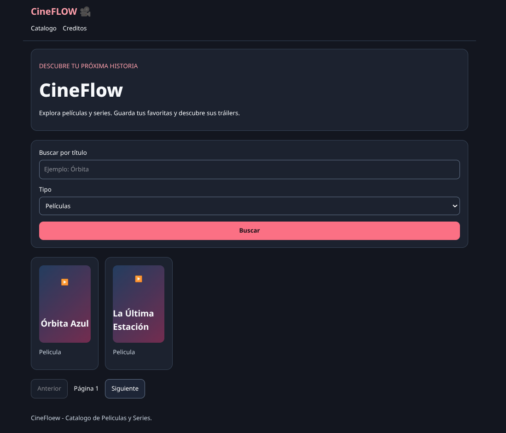
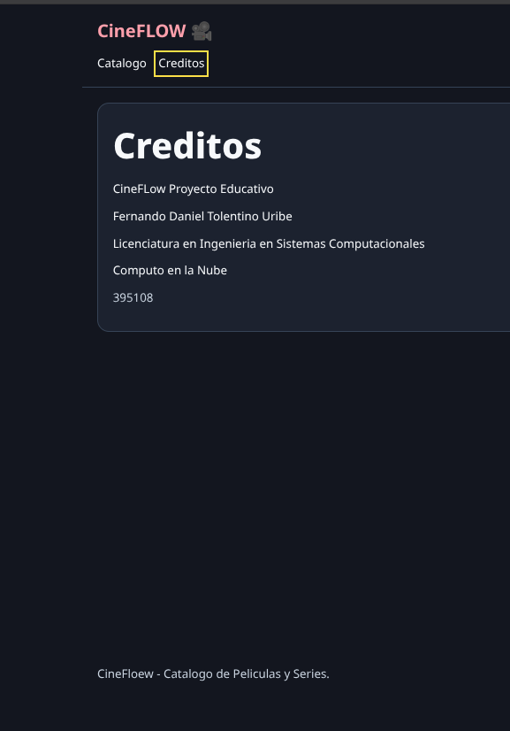
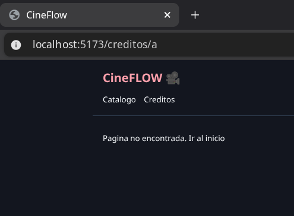

# Evidencia — Etapa 2: Enrutamiento con React Router, Catálogo Interactivo y Sección de Créditos

**Nombre:** Fernando Daniel Tolentino Uribe  
**NUA:** 395108  
**Universidad:** Universidad de Guanajuato (DICIS, Campus Irapuato-Salamanca)  
**Carrera:** Ingeniería en Sistemas Computacionales  
**Materia:** Cómputo en la Nube  
**Fecha:** 25 de Septiembre de 2026  

---

## 📁 `apps/web/src/App.tsx`

```tsx
import { BrowserRouter, Routes, Route, Link } from "react-router-dom";
import { Catalog } from "./Catalog";

function Layout() {
    return (
        <>
        <a href="#contenido" className="skip">
            Saltar al contenido
        </a>
        <header className="wrap border-b border-slate-700">
            <strong className="text-2xl text-rose-300">
                CineFLOW 🎥 
            </strong>
            <nav className="mt-4">
                <Link to="/">Catalogo</Link>
                <Link to="/creditos">Creditos</Link>
            </nav>
        </header>
        <main className="wrap" id="contenido">
            <Routes>
                <Route path="/" element={<Catalog />} />
                <Route 
                    path="/titulo/:type/:id"
                    element={
                        <p>
                            La ficha o tarjeta la vamos a poner despues
                            <Link to="/">Regresar</Link>
                        </p>
                    }
                />
                <Route
                    path="/creditos"
                    element={
                        <section className="panel">
                            <h1>Creditos</h1>
                            <p>CineFLow Proyecto Educativo</p>
                            <div>
                                <p>Fernando Daniel Tolentino Uribe</p>
                                <p>Licenciatura en Ingenieria en Sistemas Computacionales</p>
                                <p>Computo en la Nube</p>
                                <p className="muted">395108</p>
                            </div>
                        </section>
                    }
                />
                <Route 
                    path="*"
                    element={
                        <p>
                            Pagina no encontrada. <Link to="/">Ir al inicio</Link>
                        </p>
                    }
                />
            </Routes>
        </main>
        <footer className="wrap muted">
            CineFloew - Catalogo de Peliculas y Series.
        </footer>
        </>
    )
}

export default function App() {
    return (
        <BrowserRouter>
            <Layout />
        </BrowserRouter>
    )
}
```

---

## 📁 `apps/web/src/Catalog.tsx`

```tsx
import { Link, useSearchParams } from "react-router-dom";
import { useData } from "./useData";
import type { Media } from "./types";

export function Card({ media } : { media: Media }){ 
    return( 
        <article className="panel"> 
            <Link to={`/titulo/${media.type}/${media.id}`}> 
                <div className="poster"> 
                    { media.poster ? ( 
                         { e.currentTarget.style.display = 'none' }} /> 
                    ) : ( 
                        <span aria-hidden="true" className="text5xl">▶️</span> 
                    ) } 
                    <div> 
                        <h2 className="mt-3 text-lg">{media.title}</h2> 
                    </div> 
                </div> 
            </Link> 
            <p className="muted">
                {media.type === 'movie' ? 'Pelicula' : 'Serie'}
            </p>
        </article> 
    ) 
}

export function Catalog() {
  const [params, setParams] = useSearchParams();
  const type = params.get("tipo") === "tv" ? "tv" : "movie";
  const q = params.get("q") || "";
  const page = Math.max(1, Number(params.get("pagina")) || 1);
  const { data, error, loading, reload } = useData<Media[]>(
    `/catalog?type=${type}&q=${encodeURIComponent(q)}&page=${page}`,
  );
  return (
    <>
      <section className="panel mb-6">
        <p className="text-rose-300">DESCUBRE TU PRÓXIMA HISTORIA</p>
        <h1>CineFlow</h1>
        <p>
          Explora películas y series. Guarda tus favoritas y descubre sus
          tráilers.
        </p>
      </section>
      <form
        className="panel mb-6"
        onSubmit={(e) => {
          e.preventDefault();
          const f = new FormData(e.currentTarget);
          setParams({
            tipo: String(f.get("tipo")),
            q: String(f.get("q")),
            pagina: "1",
          });
        }}
      >
        <label>
          Buscar por título
          <input
            key={q}
            name="q"
            defaultValue={q}
            maxLength={100}
            placeholder="Ejemplo: Órbita"
          />
        </label>
        <label>
          Tipo
          <select key={type} name="tipo" defaultValue={type}>
            <option value="movie">Películas</option>
            <option value="tv">Series</option>
          </select>
        </label>
        <button className="btn primary">Buscar</button>
      </form>
      {loading ? (
        <p role="status">Cargando catálogo…</p>
      ) : error ? (
        <div className="error" role="alert">
          {error}{" "}
          <button className="btn" onClick={reload}>
            Reintentar
          </button>
        </div>
      ) : (
        <>
          <div className="grid-media">
            {data?.map((m) => (
              <Card key={`${m.type}_${m.id}`} media={m} />
            ))}
          </div>
          {data?.length === 0 && <p>No hay resultados. Prueba otro título.</p>}
          <nav className="mt-6">
            <button
              className="btn"
              disabled={page <= 1}
              onClick={() =>
                setParams({ tipo: type, q, pagina: String(page - 1) })
              }
            >
              Anterior
            </button>
            <span>Página {page}</span>
            <button
              className="btn"
              disabled={!data?.length || page >= 500}
              onClick={() =>
                setParams({ tipo: type, q, pagina: String(page + 1) })
              }
            >
              Siguiente
            </button>
          </nav>
        </>
      )}
    </>
  );
}
```

---

## 📁 `apps/web/src/useData.ts`

```typescript
import { useEffect, useState } from "react";
import { request } from "./api";

export function useData<T>(path: string) {
    const [ state,setState ] = useState<{
        path: string;
        data?: T;
        error?: string;
        loading: boolean;
    }>({ path, loading: true});
    const [ retry, setRetry ] = useState(0)
    useEffect(() => {
        const controller = new AbortController()
        setState({ path, loading: true })
        request<T>(path, {
            signal: controller.signal
        }).then((data) => setState({
            path,
            data,
            loading: false
        })).catch((e) => {
            if (!controller.signal.aborted) {
                setState({
                    path,
                    error: e instanceof Error ? e.message : 'Error de conexion',
                    loading: false
                })
            }
        })
        return () => controller.abort()
    }, [path, retry])
    return {
        ...(state.path === path ? state: { path, loading: true}),
        reload: () => setRetry((x) => x + 1)
    }
}
```

---

## 📸 Evidencias Visuales de Ejecución

### 1. Catálogo Interactivo (`http://localhost:5173/`)
Vista principal de CineFlow con navegación superior, formulario de filtrado por búsqueda y tipo (Películas / Series), listado reactivo de tarjetas multimedia y paginación funcional.



---

### 2. Sección de Créditos (`http://localhost:5173/creditos`)
Ruta de créditos renderizada mediante React Router DOM, mostrando la información académica del estudiante, programa educativo y materia.



---

### 3. Página No Encontrada (`http://localhost:5173/*`)
Manejo de rutas no coincidentes (404) mediante la ruta comodín `*` de React Router, mostrando el mensaje de página no encontrada con enlace para regresar al inicio.



