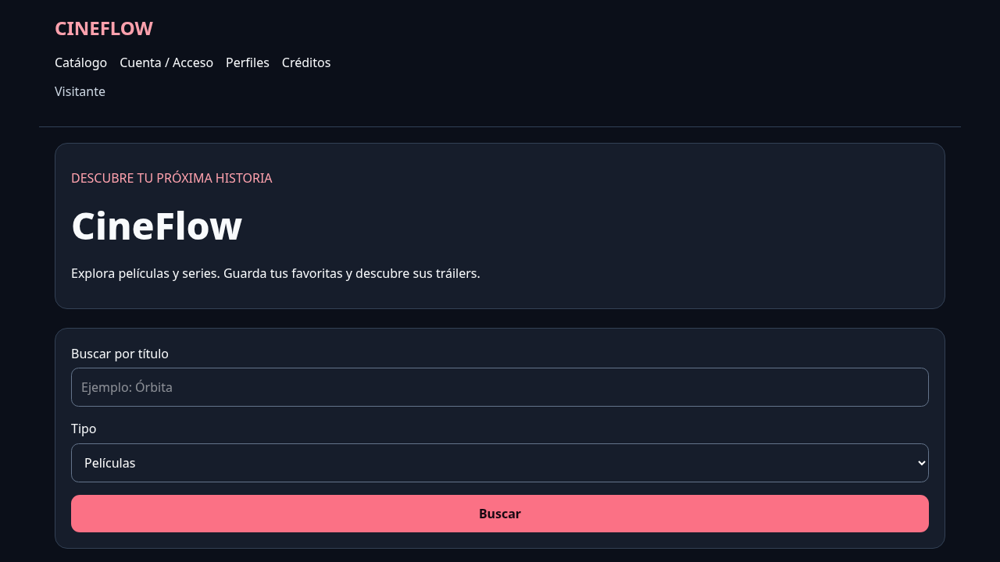
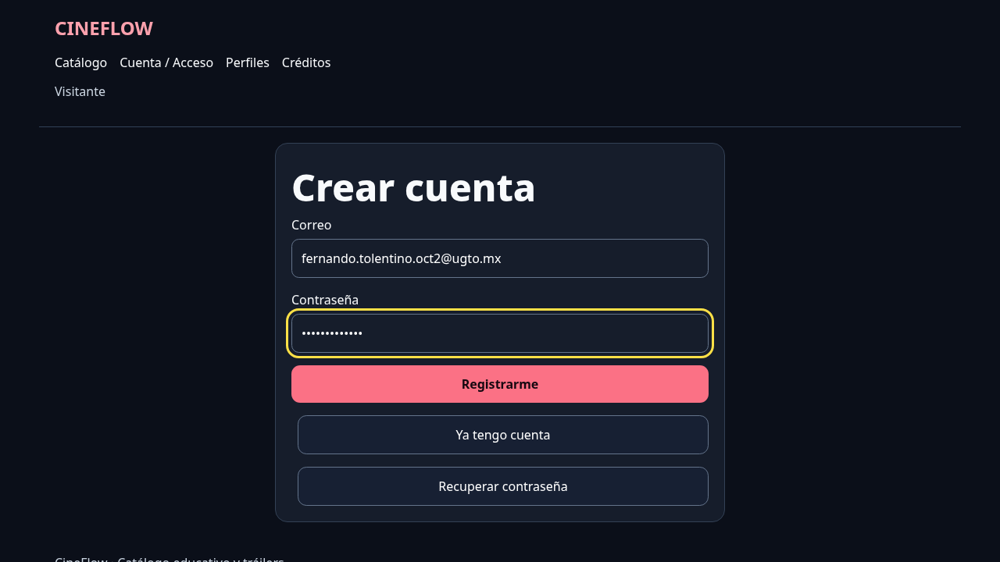
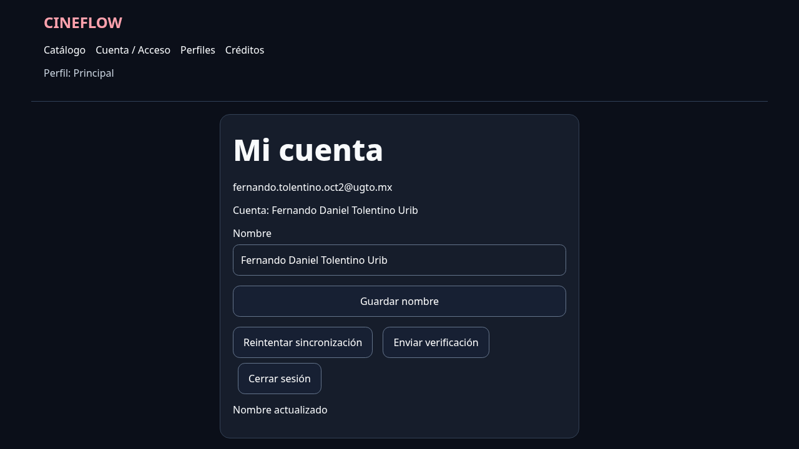
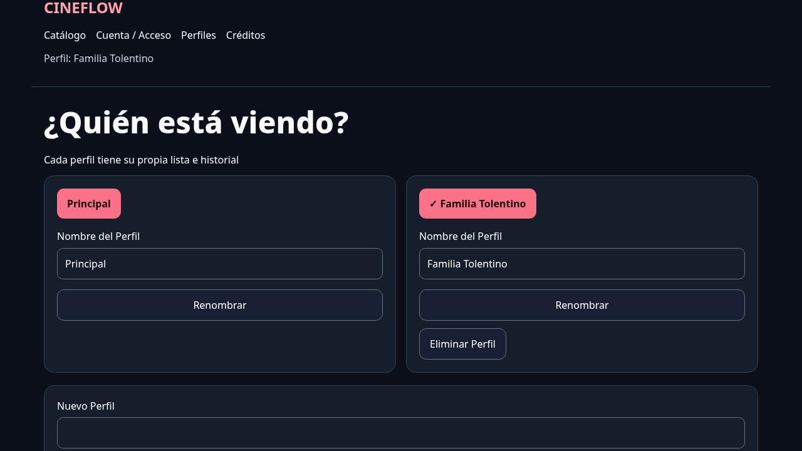
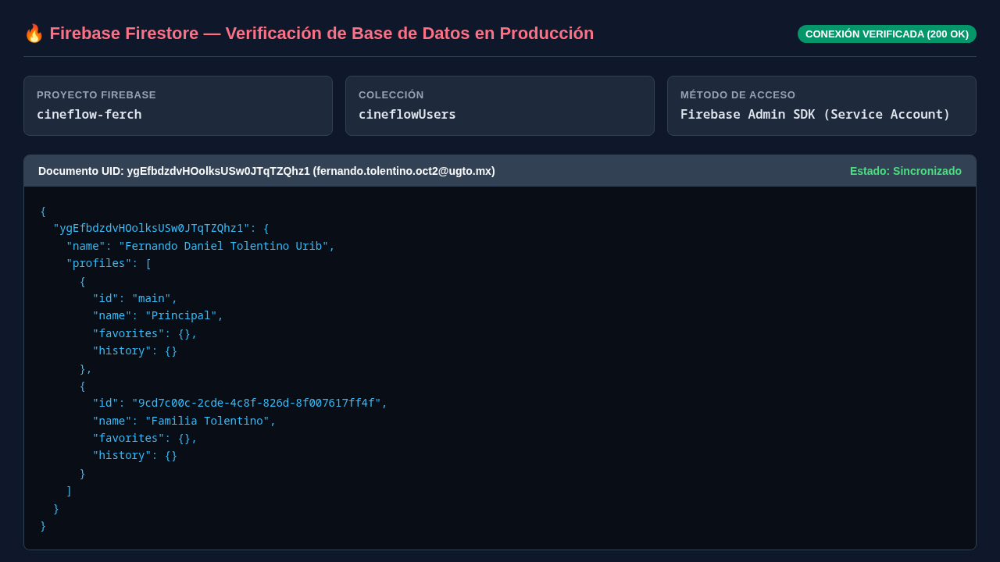

# Evidencia: Etapa 5 - Perfiles de Usuario, Firebase Admin SDK y Persistencia en Firestore

**Nombre:** Fernando Daniel Tolentino Uribe  
**NUA:** 395108  
**Universidad:** Universidad de Guanajuato (DICIS, Campus Irapuato-Salamanca)  
**Carrera:** Ingeniería en Sistemas Computacionales  
**Materia:** Cómputo en la Nube  
**Fecha:** 2 de Octubre de 2026  

---

## 📁 `apps/api/src/store.ts`

```ts
import { cert, getApps, initializeApp } from "firebase-admin/app";
import { getAuth } from "firebase-admin/auth";
import { getFirestore } from "firebase-admin/firestore";
import { emptyAccount, Problem, type Account } from "./model.js";

function app() {
  const existing = getApps()[0];
  if (existing) return existing;

  const projectId = process.env.FIREBASE_PROJECT_ID?.trim();
  const clientEmail = process.env.FIREBASE_CLIENT_EMAIL?.trim();
  // Acepta saltos reales y la secuencia literal \n de los paneles de hosting.
  const privateKey = process.env.FIREBASE_PRIVATE_KEY
    ?.replace(/\\n/g, "\n")
    .trim();
  if (!projectId || !clientEmail || !privateKey)
    throw new Problem(
      503,
      "Configura FIREBASE_PROJECT_ID, FIREBASE_CLIENT_EMAIL y FIREBASE_PRIVATE_KEY en el backend",
    );

  try {
    return initializeApp({
      credential: cert({ projectId, clientEmail, privateKey }),
      projectId,
    });
  } catch {
    // No devolver la clave ni detalles internos de las credenciales al cliente.
    throw new Problem(
      503,
      "Configuración Firebase inválida. Revisa las variables del backend.",
    );
  }
}

export async function verify(token: string): Promise<string> {
  const a = app();
  try {
    return (await getAuth(a).verifyIdToken(token, true)).uid;
  } catch {
    throw new Problem(401, "Sesión inválida. Vuelve a iniciar sesión.");
  }
}

export interface Store {
  read(uid: string): Promise<Account>;
  change<T>(uid: string, fn: (account: Account) => T): Promise<T>;
}

export const store: Store = {
  async read(uid) {
    const snapshot = await getFirestore(app())
      .collection("cineflowUsers")
      .doc(uid)
      .get();
    return snapshot.exists ? (snapshot.data() as Account) : emptyAccount();
  },
  async change(uid, fn) {
    const db = getFirestore(app());
    const ref = db.collection("cineflowUsers").doc(uid);
    return db.runTransaction(async (tx) => {
      const snap = await tx.get(ref);
      const state = snap.exists ? (snap.data() as Account) : emptyAccount();
      const result = fn(state);
      if (Buffer.byteLength(JSON.stringify(state)) > 400000)
        throw new Problem(
          409,
          "La cuenta alcanzó el límite de esta versión educativa",
        );
      tx.set(ref, state);
      return result;
    });
  },
};
```

---

## 📁 `apps/api/.env.example`

```env
PORT=4000
CORS_ORIGIN=http://localhost:5173
CATALOG_MODE=demo
TMDB_READ_ACCESS_TOKEN=
FIREBASE_PROJECT_ID=
FIREBASE_CLIENT_EMAIL=
FIREBASE_PRIVATE_KEY=
```

---

## 📁 `apps/web/src/Profiles.tsx`

```tsx
import { useState } from "react";
import { Link } from "react-router-dom";
import { useSession } from "./Session";

export function Profiles() {
  const { user, loading, account, profile, call, refresh, select } =
    useSession();
  const [error, setError] = useState("");
  const [busy, setBusy] = useState(false);

  async function change(path: string, method: string, name?: string) {
    setError("");
    setBusy(true);
    try {
      await call(path, {
        method,
        ...(name ? { body: JSON.stringify({ name }) } : {}),
      });
      await refresh();
    } catch (error) {
      setError((error as Error).message);
    } finally {
      setBusy(false);
    }
  }

  if (loading) {
    return <p>Cargando...</p>;
  }

  if (!user) {
    return (
      <Link className="btn" to="/acceso">
        Inicia Sesión para Administrar tu Perfil
      </Link>
    );
  }

  if (!account) {
    return (
      <Link className="btn border-t-red-700" to="/acceso">
        Sincroniza tu cuenta primero
      </Link>
    );
  }

  return (
    <>
      <h1>¿Quién está viendo?</h1>
      <p>Cada perfil tiene su propia lista e historial</p>
      {error && (
        <p role="alert" className="error">
          {error}
        </p>
      )}
      <div className="grid gap-4 sm:grid-cols-2">
        {account.profiles.map((p) => (
          <article className="panel" key={p.id}>
            <button
              className="btn primary"
              onClick={() => select(p.id)}
              aria-pressed={profile?.id === p.id}
            >
              {profile?.id === p.id ? "✓ " : ""}
              {p.name}
            </button>
            <form
              className="mt-4"
              onSubmit={(e) => {
                e.preventDefault();
                void change(
                  `/profiles/${p.id}`,
                  "PATCH",
                  String(new FormData(e.currentTarget).get("name")),
                );
              }}
            >
              <label>
                Nombre del Perfil
                <input
                  name="name"
                  defaultValue={p.name}
                  maxLength={30}
                  required
                />
              </label>
              <button className="btn" disabled={busy}>
                Renombrar
              </button>
            </form>
            {p.id !== "main" && (
              <button
                className="btn mt-3"
                disabled={busy}
                onClick={() => {
                  if (
                    confirm(
                      "¿Estás seguro de eliminar el perfil y su historial?",
                    )
                  ) {
                    void change(`/profiles/${p.id}`, "DELETE");
                  }
                }}
              >
                Eliminar Perfil
              </button>
            )}
          </article>
        ))}
      </div>
      <form
        className="panel mt-5"
        onSubmit={(e) => {
          e.preventDefault();
          const form = e.currentTarget;
          void change(
            "/profiles",
            "POST",
            String(new FormData(form).get("name")),
          ).then(() => form.reset());
        }}
      >
        <label>
          Nuevo Perfil
          <input name="name" maxLength={30} required />
        </label>
        <button
          className="btn"
          disabled={busy || account.profiles.length >= 5}
        >
          Crear Perfil ({account.profiles.length}/5)
        </button>
      </form>
    </>
  );
}
```

---

## 📁 `apps/web/src/App.tsx`

```tsx
import { BrowserRouter, Routes, Route, Link } from "react-router-dom";
import { Catalog } from "./Catalog";
import { Detail } from "./Detail";
import { Session, useSession } from "./Session";
import { Access } from "./Access";
import { Profiles } from "./Profiles";

function Layout() {
  const { profile, user } = useSession();
  return (
    <>
      <a className="skip" href="#contenido">
        Saltar al contenido
      </a>
      <header className="wrap border-b border-slate-700">
        <strong className="text-2xl text-rose-300">CINEFLOW</strong>
        <nav className="mt-4">
          <Link to="/">Catálogo</Link>
          <Link to="/acceso">Cuenta / Acceso</Link>
          <Link to="/perfiles">Perfiles</Link>
          <Link to="/creditos">Créditos</Link>
        </nav>
        <p className="muted">
          {user ? `Perfil: ${profile?.name || "sincronizando"}` : "Visitante"}
        </p>
      </header>
      <main id="contenido" className="wrap">
        <Routes>
          <Route path="/" element={<Catalog />} />
          <Route path="/titulo/:type/:id" element={<Detail />} />
          <Route path="/acceso" element={<Access />} />
          <Route path="/perfiles" element={<Profiles />} />
          <Route
            path="/creditos"
            element={
              <section className="panel">
                <h1>Créditos</h1>
                <p>CineFlow es un proyecto educativo de catálogo y tráilers.</p>
                <p>
                  This product uses the TMDB API but is not endorsed or
                  certified by TMDB.
                </p>
                <p>
                  <a href="https://www.themoviedb.org/">
                    Datos e imágenes: TMDB
                  </a>
                  . Reproducción: YouTube.
                </p>
                <p>
                  Antes de publicar, agrega aquí el logo oficial aprobado de
                  TMDB según su guía de atribución.
                </p>
              </section>
            }
          />
          <Route
            path="*"
            element={
              <p>
                Página no encontrada. <Link to="/">Ir al inicio</Link>
              </p>
            }
          />
        </Routes>
      </main>
      <footer className="wrap muted">
        CineFlow · Catálogo educativo y tráilers
      </footer>
    </>
  );
}

export default function App() {
  return (
    <BrowserRouter>
      <Session>
        <Layout />
      </Session>
    </BrowserRouter>
  );
}
```

---

## 📸 Capturas de Evidencia

### 1. Catálogo Inicial con Ruta a Perfiles


### 2. Formulario de Registro en Firebase


### 3. Cuenta Registrada y Sincronizada con Backend


### 4. Gestión de Perfiles y Creación de Perfil Secundario


### 5. Validación en Base de Datos Firestore (`cineflowUsers`)


---

## 🎬 Demostración en Video

El video donde se demuestra el registro completo, navegación, sincronización y validación de datos en la base de datos se encuentra disponible en:
- `docs/evidencia_video_2oct.mp4`
- `docs/evidencia_video_2oct.webm`
